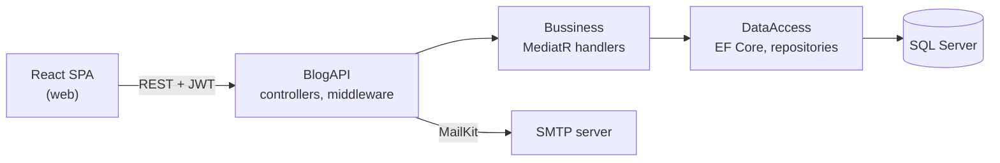

#  Blogostra - BlogAppFullStack

A full-stack blogging platform. Readers browse, search and filter posts, like them and comment. Administrators manage posts, comments and users and follow monthly statistics. The backend is an ASP.NET Core 8 Web API with JWT authentication and rotating refresh tokens; the frontend is a React and TypeScript single-page app with light and dark themes, Turkish and English, and SEO support.

## Contents

- [Features](#features)
- [Architecture](#architecture)
- [Tech stack](#tech-stack)
- [Repository layout](#repository-layout)
- [Getting started](#getting-started)
- [Authentication across the stack](#authentication-across-the-stack)
- [Backend](#backend)
- [Frontend](#frontend)
- [Testing](#testing)
- [Known limitations](#known-limitations)
- [Roadmap](#roadmap)

## Features

**For readers**

- Post list with pagination, search and category filtering
- Post page with likes and comments
- Registration with email verification, login, logout
- Account page: edit profile, change password, delete account
- Light and dark theme, Turkish and English interface (choices are remembered)

**For administrators**

- Create, edit and delete posts (with image upload)
- Delete comments, suspend users
- Monthly post, comment and like charts for a chosen date range

**Platform**

- JWT access tokens with rotating refresh tokens stored as hashes
- Role-based access on both the API and the UI routes
- Centralized error responses with a trace id
- SEO tags, clean post URLs, generated `sitemap.xml` and `robots.txt`
- Google Analytics 4 that loads only after the visitor accepts cookies

## Architecture



The API keeps dependencies pointing inward. `BlogAPI` depends on `Bussiness` and `DataAccess`. `DataAccess` implements the repository interfaces declared in `Bussiness`. `Bussiness` knows only `Entities`, `Dto` and `Utilities`, with no reference to EF Core, MailKit or a JWT library.

The SPA talks to the API only through one data layer (`src/api`). Components never call axios directly.

## Tech stack

| Layer | Technologies |
| --- | --- |
| Backend | .NET 8, ASP.NET Core Web API, Entity Framework Core 8 (code-first, migrations, seed data), SQL Server, ASP.NET Core Identity, JWT bearer authentication, MediatR, Serilog, MailKit |
| Backend tests | xUnit, WebApplicationFactory, Testcontainers (SQL Server) |
| Frontend | React 18, TypeScript 5.9 (strict), Vite 8, React Router 7, TanStack Query 5, axios, Tailwind CSS 4, i18next, recharts, react-helmet-async |
| Frontend quality | ESLint (typescript-eslint, react-hooks), Prettier |

## Repository layout

```
.
├── api/            ASP.NET Core solution (see Backend)
├── web/            React app (see Frontend)
└── README.md
```

## Getting started

### Prerequisites

- .NET 8 SDK
- SQL Server reachable from your machine
- Node.js 22
- Docker (only needed to run the backend integration tests)

### 1. API

Create `api/BlogAPI/appsettings.Local.json`. It is ignored by git and loaded only in the Development environment.

```json
{
  "JWT": { "Key": "at-least-32-characters-long-random-string" },
  "EmailSender": { "Email": "sender@example.com", "Password": "smtp-app-password" }
}
```

Set `ConnectionStrings:DefaultConnection` for your SQL Server, then:

```
cd api
dotnet restore
dotnet ef database update --project DataAccess --startup-project BlogAPI
dotnet run --project BlogAPI
```

Swagger is available in the Development environment. Logs go to the console and to `BlogAPI/logs/`.

The API must allow the frontend origin in its CORS policy (`http://localhost:3000` in development). If the browser rejects the HTTPS development certificate, run `dotnet dev-certs https --trust` once.

### 2. Frontend

```
cd web
npm install
cp .env.example .env
npm run dev
```

The app opens at `http://localhost:3000`.

### Environment variables

**Frontend (`web/.env`)**

| Variable | Meaning |
| --- | --- |
| `VITE_API_URL` | API base URL, for example `https://localhost:7197/api` |
| `VITE_SITE_URL` | Public site URL, used for canonical links, sitemap and robots |
| `VITE_GA_ID` | GA4 measurement ID. When empty, analytics and the cookie banner are disabled |

**Backend** (`appsettings.json` contains no secrets; supply these in production as environment variables)

```
JWT__Key
EmailSender__Email
EmailSender__Password
ConnectionStrings__DefaultConnection
```

| Key | Default | Meaning |
| --- | --- | --- |
| `JWT:DurationInMinutes` | 120 | Access token lifetime |
| `JWT:RefreshTokenDays` | 7 | Refresh token lifetime (1 to 90) |
| `Client:BaseUrl` | `http://localhost:3000` | Base URL used in verification emails |
| `EmailSender:Host` / `Port` | `smtp.gmail.com` / 465 | SMTP server |

The API stops at startup with a clear message if the JWT key is missing or shorter than 32 bytes.

## Authentication across the stack

1. **Login.** The API returns the access token in the `Authorization` response header and the refresh token in the `RefreshToken` header. The SPA stores both in `localStorage`.
2. **Startup.** When the app opens, the SPA refreshes an expired access token first, then calls `ValidateToken` to load the user and role.
3. **Refresh tokens rotate.** The API stores refresh tokens as SHA-256 hashes with an expiry. Every refresh deletes the used token and issues a new one, so a replayed token is rejected. Each login gets its own token, so sessions on several devices do not affect each other.
4. **Single-flight refresh on the client.** Because a used refresh token is deleted at once, two parallel refresh requests would make the second one look like a replay and fail. The axios interceptor therefore sends one refresh request at a time. Concurrent 401 responses wait for it, then retry once with the new token.
5. **Failure.** If the refresh fails, the SPA clears its tokens, ends the session and redirects to the login page. Logging in again returns the visitor to the page they came from.
6. **Roles.** The API enforces roles on every administrator endpoint. The SPA's route guards only decide what to show.

Verification emails link to the frontend's `/EmailVerification` page, which confirms the address through the API.

## Backend

ASP.NET Core 8 backend: user accounts with email verification, JWT authentication with rotating refresh tokens, posts, likes and comments, and an administrator area with user management and statistics.

### Solution layout

| Project | Responsibility |
| --- | --- |
| `Entities` | Entities with encapsulated state and behavior |
| `Dto` | Request and response models, error response shape. No dependencies |
| `Utilities` | Dependency-free helpers: token hashing and generation, claim names, confirmation email builder, settings classes |
| `Bussiness` | MediatR requests and handlers grouped by feature, repository and service interfaces, exceptions, mapping, pipeline behavior |
| `DataAccess` | `DbContext`, entity configurations, repositories, migrations, Identity stores |
| `BlogAPI` | Controllers, exception middleware, JWT and SMTP implementations, JWT bearer configuration, Serilog setup, `Program.cs` |
| `IntegrationTests` | End-to-end tests against a real SQL Server container |

Controllers stay thin and only send a request through `ISender`. Each use case lives in `Bussiness/Features/<Area>/` as a command or query record next to its handler. The JWT and SMTP implementations of `ITokenService` and `IMailTransport` live in `BlogAPI/Services`.

### Design notes

- **Encapsulated entities.** State changes go through factory and behavior methods (`Post.Create`, `Post.Revise`, `User.Suspend`, `RefreshToken.Issue`). Setters are private.
- **Centralized error handling.** `ExceptionHandlingMiddleware` maps typed exceptions (`NotFoundException`, `ConflictException`, `UnauthorizedException`, ...) to a single JSON error shape with `status`, `code`, `message`, `traceId` and optional `errors`. Model validation failures use the same shape.
- **Current user.** User identity comes from the `uid` claim through `ICurrentUser`. Request bodies never decide who the caller is.
- **Response models.** Posts, comments and likes are returned as response DTOs, never as tracked entities. User responses do not contain password hashes or security stamps.
- **Utilities.** Pure helpers that need no framework live in `Utilities`, so `Bussiness` and `BlogAPI` can both use them without depending on each other.
- **Logging.** Serilog request logging plus a MediatR behavior that records handler duration. Passwords and tokens are never logged.

### Endpoints

| Area | Method and route | Access |
| --- | --- | --- |
| Auth | `POST /api/Auth/Register` | Anonymous |
| Auth | `POST /api/Auth/SendMail` | Anonymous |
| Auth | `POST /api/Auth/Emailverification` | Anonymous |
| Auth | `POST /api/Auth/Login` | Anonymous |
| Auth | `POST /api/Auth/RefreshToken` (header `RefreshToken`) | Anonymous |
| Auth | `POST /api/Auth/ValidateToken` | Authenticated |
| User | `PUT /api/User/UpdateAccount`, `PUT /api/User/ChangePassword`, `DELETE /api/User/DeleteAccount` | Authenticated |
| Post | `GET /api/Post/GetAllPostsByIndex`, `GetPostById`, `GetPostCounts`, `GetPostBySearch` | Anonymous |
| Post | `POST /api/Post/LikeThePost`, `DislikeThePost` | Authenticated |
| Comment | `POST /api/Comment/AddCommentToPost` | Authenticated |
| Admin | `GetAllUsers`, `GiveRoleToUser`, `SuspendUser`, `AddPost`, `UpdatePost`, `RemovePost`, `DeleteCommentFromPost`, `GetAllStatistics` | Administrator |

## Frontend

React single-page app built with Vite and TypeScript (strict).

### Architecture

- **`api/`**: every HTTP call. Two axios instances: `api` for public requests and `authApi`, which adds the token and renews the session on 401.
- **`hooks/`**: TanStack Query wrappers. Query keys live in one file; adding, updating or deleting a post invalidates the related lists.
- **`auth/`**: `AuthProvider` holds the user and role. `RequireAuth` is a layout route that protects pages for anonymous visitors, signed-in users and administrators.
- **`context/`**: theme and cookie-consent state.
- Administrator pages are lazy-loaded, so the chart library is only downloaded when the chart page opens.

### Design system

- Colors and fonts are CSS variables in `src/styles/index.css`. Dark mode swaps the same variables under a `.dark` class, and a small inline script in `index.html` applies the saved theme before first paint to avoid a flash.
- Every category has its own hue (`data-category`). The category dot, the post cover and the like highlight all derive from it. Posts without an image get a colored cover with the title's first letter.
- Fonts: Bricolage Grotesque for the interface and Literata for reading text, served locally through `@fontsource-variable`.
- Styling is plain Tailwind classes. A few repeated class strings (button, input, table) live in `src/lib/classes.ts`. The modal is the native `<dialog>` element, and selects and tables are native elements.

### SEO and analytics

- Each page sets its title, description, canonical URL and Open Graph tags through a `Seo` component. Sign-in, account and administrator pages are `noindex`.
- Posts use clean URLs such as `/post/12/istanbul-notes`. The slug transliterates Turkish characters.
- `npm run build` first runs `scripts/generate-seo-files.mjs`, which writes `sitemap.xml` and `robots.txt` for `VITE_SITE_URL`.
- Google Analytics 4 loads only when `VITE_GA_ID` is set and the visitor has accepted cookies. Page views are sent manually on route changes, and the choice can be changed from the footer.

### Folder structure

```
web/
├── scripts/            sitemap and robots generator
├── public/             static files
└── src/
    ├── api/            axios instances, endpoint functions, token handling
    ├── auth/           AuthProvider, RequireAuth, session loading
    ├── components/     PostCard, Pager, Field, Modal, CookieBanner, Seo, layout/
    ├── constants/      categories, page sizes, site name
    ├── context/        theme and consent contexts
    ├── hooks/          TanStack Query hooks and query keys
    ├── i18n/           i18next setup, locales/en and locales/tr
    ├── lib/            query client, shared Tailwind classes, GA4 loader
    ├── pages/          public pages and admin/ pages
    ├── styles/         Tailwind entry and theme variables
    ├── types/          shared types
    └── utils/          date, image, slug, language, error and token helpers
```

### Scripts

| Command | Purpose |
| --- | --- |
| `npm run dev` | Development server on port 3000 |
| `npm run build` | Type check, generate sitemap and robots, production build |
| `npm run preview` | Serve the production build locally |
| `npm run lint` | ESLint |
| `npm run format` | Prettier |

## Testing

**Backend.** The integration tests start a disposable SQL Server container, apply the migrations and exercise the real HTTP pipeline. Docker must be running.

```
cd api
dotnet test
```

Covered flows: register, email confirmation, login and refresh; refresh token expiry, rotation and replay; posts, likes and comments; account update, password change and deletion; administrator role changes, suspension and statistics; error response format and authorization failures. Outgoing mail is captured in memory, and the clock can be advanced in tests to check token expiry.

**Frontend.** There are no automated tests yet. During development the main flows (login, route guards, token refresh, filtering, cookie consent) were checked in a real browser against a mocked API.

## Known limitations

- `SendMail` reveals whether an account exists.
- An access token stays valid until it expires, even if the account is suspended afterwards. Lower `JWT:DurationInMinutes` to shorten that window.
- Posts require an image because the column is not nullable.
- The role-assignment endpoint (`GiveRoleToUser`) has no screen in the UI yet.
- Tokens are kept in `localStorage`. An `httpOnly` cookie would be safer against XSS; this is a deliberate simplification.
- The SPA is client-rendered. Search engines can read it, but link-preview bots (for example Twitter or WhatsApp) show the site-wide preview instead of one specific to the post. Server rendering or pre-rendering would fix this.
- The sitemap lists only the static pages. Post URLs need a list endpoint on the API.

## Roadmap

- Dockerfiles and a compose file that runs the API, SQL Server and the web app together
- Frontend unit and component tests
- Post URLs in the sitemap
